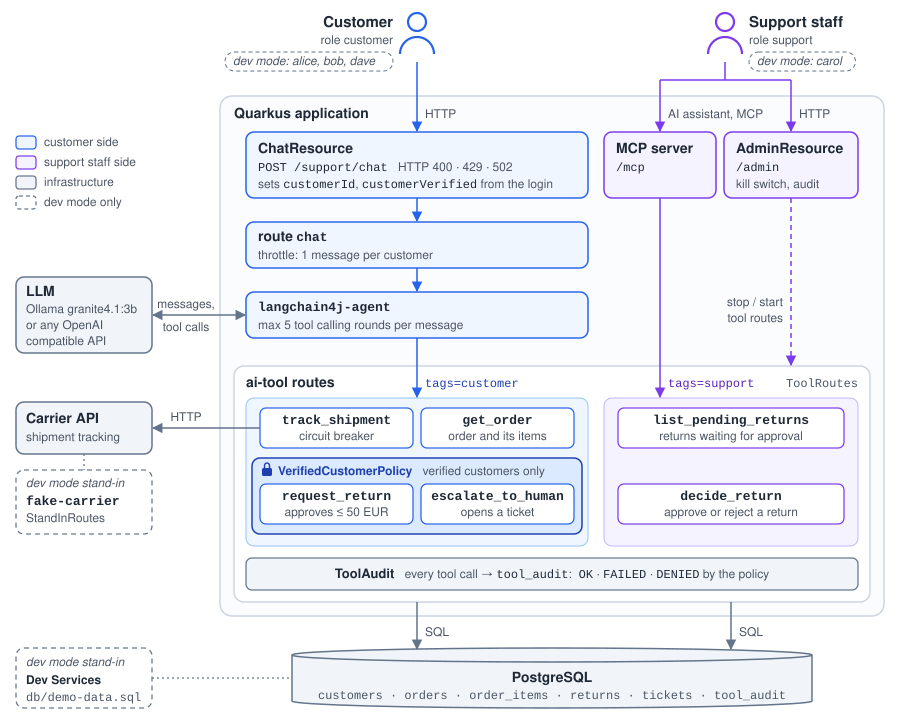
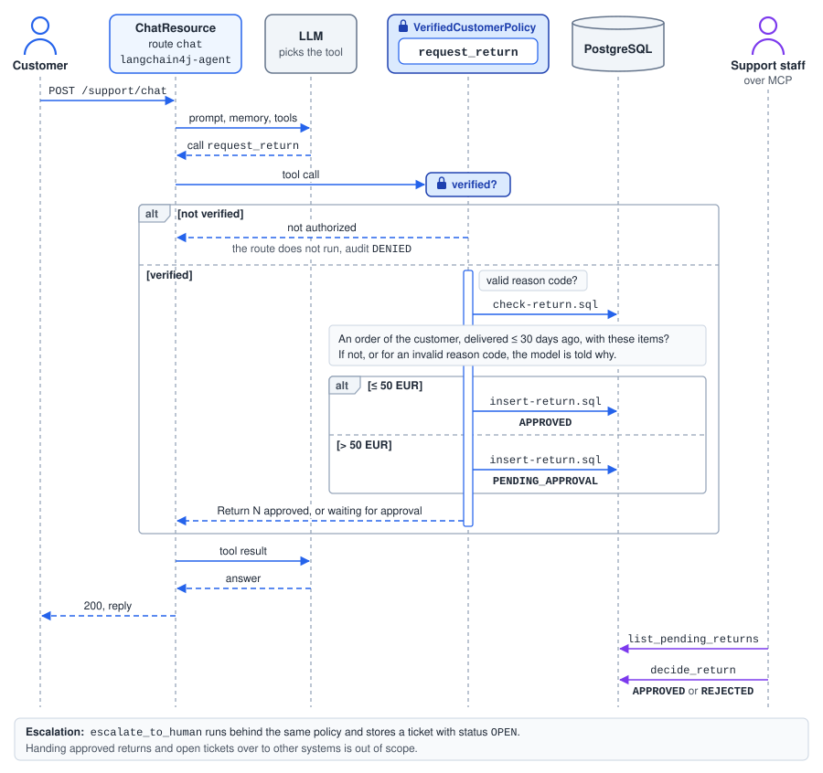

= AI Tool Support Desk with LangChain4j and MCP: A Camel Quarkus example
:cq-example-description: An example that shows how to serve Camel routes as AI tools to a LangChain4j agent and, over MCP, to the AI assistant of the support staff

{cq-description}

TIP: Check the https://camel.apache.org/camel-quarkus/latest/first-steps.html[Camel Quarkus User guide] for prerequisites
and other general information.

== What the example does

The support desk of an online shop. Customers chat with an AI assistant about their orders, and the support staff
use an AI assistant of their own, for example Claude Code, over the Model Context Protocol (MCP). Both assistants call
Camel routes as tools: the `ai-tool` component (`camel-quarkus-ai-tool`) turns a route into a tool, and the tags of
the tool routes in `ToolRoutes` tell the two audiences apart. Every tool must have a tag, because an untagged tool is
offered to every agent, whatever tags the agent asks for.

[cols="2,4,7",options="header"]
|===
|Component |Class / route id |Purpose
|Customer API |`ChatResource`, route `customer-returns` |`POST /support/chat`, `GET /support/returns`. Sets `customerId` and `customerVerified` from the logged-in user.
|Chat |route `chat` |Throttle, prompt `prompts/support-agent.txt`, memory per customer, `langchain4j-agent` with `tags=customer`.
|Agent setup |`SupportAgentConfiguration` |Chat model (`support-desk.llm.*`), last 20 messages per customer, generic text for failing or unknown tools.
|Customer tools |`ToolRoutes`: `get_order`, `track_shipment`, `request_return`, `escalate_to_human` |Only for the logged-in customer: the SQL uses `customerId`, never an argument.
|Support tools |`ToolRoutes`: `list_pending_returns`, `decide_return` |Published at `/mcp` (`quarkus.camel.mcp-server.tags=support`), role `support` only.
|Authorization |`VerifiedCustomerPolicy` (bean `verifiedCustomers`) |Lets only verified customers call `request_return` and `escalate_to_human`. A denied call never runs the route.
|Audit |`ToolAudit` |Writes every tool call to `tool_audit`: route policy (`OK`, `FAILED`), `AiToolAuthorizationDeniedEvent` (`DENIED`).
|Admin API |`AdminResource`, route `tool-audit-log` |Kill switch `POST /admin/tools/{tool}/disable` and `/enable`, `GET /admin/audit`. Role `support`.
|Database |`db/schema.sql`, `sql/*.sql` |The tables, and the SQL of the tools (short statements are inline in the routes).
|Dev stand-ins |route `fake-carrier` (`StandInRoutes`), Dev Services, `%dev` users |The carrier, PostgreSQL with `db/demo-data.sql`, users `alice`, `bob`, `dave` and `carol`.
|===

* Customers chat at `POST /support/chat`. The `chat` route calls the `langchain4j-agent` component
  (`camel-quarkus-langchain4j-agent`) with `tags=customer`, so the model gets the customer tools:
** `get_order` reads an order of the customer with its items from PostgreSQL.
** `track_shipment` asks the carrier API about an order on its way, in a circuit breaker.
** `request_return`, for verified customers, returns items of an order delivered at most 30 days ago. A return of up
   to 50 EUR is approved right away, a larger one waits for the support staff. The items are nested arguments,
   described by the JSON schema in `schemas/request-return.json`.
** `escalate_to_human`, for verified customers, stores a ticket in the `tickets` table, where it stays `OPEN`.
   Handing it over to a ticketing system is out of scope.
* The `camel-quarkus-mcp-server` extension publishes the tools tagged `support` at `/mcp`:
** `list_pending_returns` lists the returns that wait for approval, with their order, items and customer.
** `decide_return` approves or rejects a pending return. Deciding again changes nothing.

Paying the refund is out of scope: a real system would hand the approved return over to a payment system, for example
via Kafka.

The endpoint options of a tool route describe the tool to the model (`description`, `parameter.*` or `argSchema`, and
MCP hints such as `readOnlyHint`), and its steps hold the business rules. The model only chooses a tool and its
arguments. In particular, it cannot:

* Choose the customer. `ChatResource` hands the authenticated user to the routes in the `customerId` exchange property,
  and the SQL statements filter by it.
* Act for a customer who may not. `VerifiedCustomerPolicy`, the `authorizationPolicy` of the write tools, only lets
  verified customers call them. It decides on the exchange properties set from the authenticated user, never on the
  arguments, and a denied call never runs the route: the model only learns that it is not authorized.
* Run away. A customer has one message in progress at most (another one gets HTTP 429), and the model gets at most 5
  rounds of tool calls per message (`maxToolCallingRoundTrips`). Then the customer gets HTTP 502, although the tool
  calls made so far stay done. A failing tool only tells the model `Tool execution failed`, and a tool it does not
  have tells it that the tool is not available.
* Feed the assistant of the support staff with text written by customers, which could carry instructions to it. The
  reason of a return is a code, and the items are named after the catalog.

Every tool call is recorded in the `tool_audit` table, without its arguments, which may contain personal data: the
tool, the caller and the outcome, `OK`, `FAILED`, or `DENIED` by the authorization policy (from the
`AiToolAuthorizationDeniedEvent`). Each tool has a kill switch: `POST /admin/tools/{tool}/disable` stops the route of
the tool, which removes it from the chat agent and from the MCP server, until `POST /admin/tools/{tool}/enable`.

== Prerequisites

The chat needs a model that can call tools. By default, the example uses
https://ollama.com/library/granite4.1:3b[granite4.1:3b] served by https://ollama.com/[Ollama] on your machine:

[source,shell]
----
docker run --rm -d -v cqex-ai-tool-support-desk-ollama:/root/.ollama -p 11434:11434 --name cqex-ai-tool-support-desk-ollama ollama/ollama:0.24.0
docker exec cqex-ai-tool-support-desk-ollama ollama pull granite4.1:3b
----

To use another server with an OpenAI compatible API, set the `SUPPORT_DESK_LLM_BASE_URL`, `SUPPORT_DESK_LLM_MODEL` and
`SUPPORT_DESK_LLM_API_KEY` environment variables. Small models are more likely to call a wrong tool.

Dev mode and the tests also need Docker or Podman, for the PostgreSQL started by Dev Services.

== Start in Development mode

[source,shell]
----
mvn clean compile quarkus:dev
----

The above command compiles the project, starts the application and lets the Quarkus tooling watch for changes in your
workspace. Any modifications in your project will automatically take effect in the running application.

TIP: Please refer to the Development mode section of
https://camel.apache.org/camel-quarkus/latest/first-steps.html#_development_mode[Camel Quarkus User guide] for more details.

In dev mode, the users are demo users with HTTP basic authentication, whose password is their user name: `alice` and
`bob` are verified customers, `dave` is a customer who has not verified their account, and `carol` is support staff.
Dev Services load the demo data of `src/main/resources/db/demo-data.sql`, and `StandInRoutes` stands in for the
carrier.

=== Chat with the support desk

[source,shell]
----
curl -s -u alice:alice -X POST http://localhost:8080/support/chat \
  -H 'Content-Type: application/json' \
  -d '{"message": "Please return the two USB-C cables of order 1001, they are too short."}'
----

[source,json]
----
{ "reply": "Your return of the two USB-C cables of order 1001 is approved, for a refund of 25.00 EUR." }
----

The customer sees their returns with `GET /support/returns`:

[source,shell]
----
curl -s -u alice:alice http://localhost:8080/support/returns
----

[source,json]
----
[ { "returnId": 3, "orderId": 1001, "amount": 25.00, "status": "APPROVED" } ]
----

Other things to ask `alice`'s assistant: to return the smart speaker of order 1002 (129 EUR, so it waits for approval)
or the desk lamp of order 1004 (delivered 60 days ago, so it is refused), where order 1003 is (tracked with the
carrier), about order 2001 (`bob`'s, so it is not found), or for a human (opens a ticket). As `dave`, the assistant can
look up order 3001, but it cannot return it nor open a ticket.

=== Use the support tools from an AI assistant

The support staff connect their AI assistant to the MCP server at `http://localhost:8080/mcp` as `carol`. With
Claude Code:

[source,shell]
----
claude mcp add --transport http support-desk http://localhost:8080/mcp \
  --header "Authorization: Basic $(printf 'carol:carol' | base64)"
----

Then ask Claude Code, for example, "Which returns wait for approval? Approve the one for the headphones." It calls
`list_pending_returns`, then `decide_return`. The https://github.com/modelcontextprotocol/inspector[MCP Inspector]
(`npx @modelcontextprotocol/inspector`, transport `Streamable HTTP`, header `Authorization: Basic Y2Fyb2w6Y2Fyb2w=`)
shows the two support tools with their hints. Without credentials the MCP server answers with HTTP 401, and customers
get HTTP 403.

=== Switch a tool off and look at the audit

[source,shell]
----
curl -s -u carol:carol -X POST http://localhost:8080/admin/tools/decide_return/disable
curl -s -u carol:carol -X POST http://localhost:8080/admin/tools/decide_return/enable
curl -s -u carol:carol http://localhost:8080/admin/audit
----

[source,json]
----
[ { "tool": "decide_return", "caller": "mcp", "outcome": "OK", "calledAt": "..." },
  { "tool": "request_return", "caller": "alice", "outcome": "OK", "calledAt": "..." } ]
----

While `decide_return` is disabled, the MCP clients are notified that the tool list changed and no longer see it.

=== Package and run the application

Once you are done with developing you may want to package and run the application.

TIP: Find more details about the JVM mode and Native mode in the Package and run section of
https://camel.apache.org/camel-quarkus/latest/first-steps.html#_package_and_run_the_application[Camel Quarkus User guide]

Outside of dev mode, there are no Dev Services, no demo data, no demo users and no stand-in. Start PostgreSQL with the
tables of `src/main/resources/db/schema.sql`, and point the application at it and at the carrier API, which must answer
`GET <url>/shipments/<trackingNumber>`:

[source,shell]
----
docker run --rm -d -p 5432:5432 -e POSTGRES_PASSWORD=postgres --name cqex-ai-tool-support-desk-postgres \
  -v ${PWD}/src/main/resources/db/schema.sql:/docker-entrypoint-initdb.d/schema.sql docker.io/library/postgres:18
export QUARKUS_DATASOURCE_JDBC_URL=jdbc:postgresql://localhost:5432/postgres
export QUARKUS_DATASOURCE_USERNAME=postgres
export QUARKUS_DATASOURCE_PASSWORD=postgres
export SUPPORT_DESK_CARRIER_URL=https://carrier.example.com
----

Configure the users, see the https://quarkus.io/guides/security-properties[Quarkus guide], or better use an identity
provider such as OpenID Connect. The login name of a customer must be their `id` in the `customers` table. Customers
need the `customer` role, and the `verified` role to request returns or open tickets. The support staff need the
`support` role.

==== JVM mode

[source,shell]
----
mvn clean package -DskipTests
java -jar target/quarkus-app/quarkus-run.jar
...
[io.quarkus] (main) camel-quarkus-examples-ai-tool-support-desk ... started in 1.163s.
----

==== Native mode

IMPORTANT: Native mode requires having GraalVM and other tools installed. Please check the Prerequisites section
of https://camel.apache.org/camel-quarkus/latest/first-steps.html#_prerequisites[Camel Quarkus User guide].

To prepare a native executable using GraalVM, run the following command:

[source,shell]
----
mvn clean package -DskipTests -Dnative
./target/*-runner
...
[io.quarkus] (main) camel-quarkus-examples-ai-tool-support-desk ... started in 0.013s.
...
----

The prompt, the tool schema and the SQL statements are loaded from the classpath, so `application.properties` includes
them in the native executable with `quarkus.native.resources.includes`.

== Testing

`SupportDeskChatTest` checks what the tool calls of the chat did, rather than the wording of the replies.
`SupportDeskMcpTest` calls the support tools with the MCP client of `quarkus-mcp-server-test`. `SupportDeskTestResource`
simulates the carrier with https://wiremock.org[WireMock], including an outage.

By default, the tests do not call a model: `OllamaTestResource` plays back the stub mappings in
`src/test/resources/mappings` with WireMock, so the tests run offline. The test mode can be changed:

[source,shell]
----
mvn clean test                    # the stub mappings answer instead of the model
mvn clean test -DtestMode=live    # the model answers, Ollama with granite4.1:3b by default
mvn clean test -DtestMode=record  # the model answers, and WireMock records stub mappings
----

Each mapping file holds one conversation turn, and each step matches the last message of the conversation, the
customer's message or the result of the previous tool call, so a wrong tool result fails the test. The mappings were
recorded against granite4.1:3b, then their matchers were rewritten that way by hand. The `simulated-*.json` mappings
were written by hand, for what a recording cannot produce on demand, such as a misbehaving or slow model. With
`-DtestMode=record`, WireMock saves the recordings to `target/wiremock/mappings`.

Integration tests (`*IT`) run the same tests against the packaged application and are executed by
`mvn clean verify -Dnative`.

== Not covered yet

* A tool call refused for invalid arguments, for example a missing required one, never reaches the route and Camel
  publishes no event for it, so the tool audit does not record it.
* The MCP server does not publish structured tool results with `outputSchema`
  (https://github.com/apache/camel-quarkus/issues/9299[camel-quarkus#9299]) nor `ai-resource` routes
  (https://github.com/apache/camel-quarkus/issues/9300[camel-quarkus#9300]) on Quarkus yet, and does not hand the
  identity of its caller to the routes (https://issues.apache.org/jira/browse/CAMEL-25406[CAMEL-25406]), so the tool
  audit records the support tools as called by `mcp`.

== Feedback

Please report bugs and propose improvements via https://github.com/apache/camel-quarkus/issues[GitHub issues of Camel Quarkus] project.
