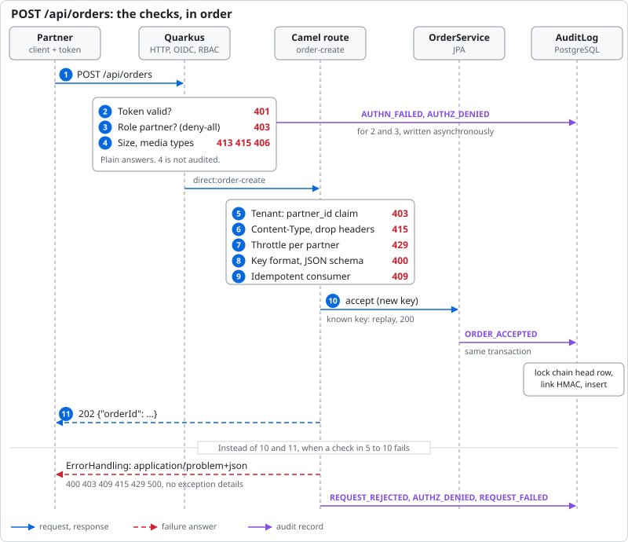

= Secure Partner Gateway: architecture

How the example is built, and what it does not do. Endpoints, setup and the production checklist are in the
link:../README.adoc[README].

== Components

[cols="2,5"]
|===
|Component |Role

|Quarkus HTTP, `quarkus-oidc`
|Token check, deny-all permissions per path, method and role, 64 KB body limit, `nosniff`. Answers `401` and `403`
before Camel.

|`GatewayRoutes`
|REST DSL on `platform-http` with the routes `order-create`, `order-read`, `audit-query` and `audit-verify`, plus the
timer route `audit-anchor`.

|`CallerIdentity`
|First step of every route. Takes the caller and the tenant (claim `partner_id`) from the verified `SecurityIdentity`,
never from headers or body.

|`ErrorHandling`
|One `routeConfiguration()`: exceptions become `application/problem+json` (RFC 9457) and an audit record.

|`ResponseHeaderFilter`
|Header filter of `platform-http`: only `Retry-After` goes out, request headers are never echoed.

|`OrderService`, `IdempotencyKeyRepository`
|Orders in PostgreSQL (JPA), tenant ownership. The repository is the Camel `JpaMessageIdRepository`, which also sees a
concurrent insert of the same key on PostgreSQL as a duplicate.

|`AuditLog`, `AuditChain`
|Append-only audit records chained with HMAC-SHA256: `append`, `query`, `verify`, `head`.

|`SecurityEventAuditor`, `CamelLifecycleAuditor`
|Audit the `401` and `403` that Quarkus answers, and the Camel context and route events.

|Flyway, PostgreSQL
|Schema, and the trigger that rejects `UPDATE`, `DELETE` and `TRUNCATE` on `audit_event`.

|Management port `9876`
|`/observe/health` and `/observe/metrics`, not on the API port.
|===

== Request flow

. The partner sends the order with a bearer token and an `Idempotency-Key`.
. Quarkus verifies the token locally: signature, issuer, audience `gateway-api`, expiry. `401` otherwise.
. Deny-all permissions: this path and method are open to the role `partner` only. `403` otherwise.
. The HTTP layer and `platform-http`: body up to 64 KB (`413`), media types the REST DSL declares (`415`, `406`).
. `CallerIdentity` builds the caller. The tenant is the signed `partner_id` claim. A partner token without it, or with a
blank one, gets `403`.
. The route accepts `application/json` only: `415` also for wildcards such as `application/*`, which `platform-http`
lets through. Then `removeHeaders` drops everything but the `Idempotency-Key`.
. Throttle per partner, 10 requests per second by default (`gateway.throttle.*`). `429` with `Retry-After`.
. The `Idempotency-Key` must match `[A-Za-z0-9_-]{8,64}`, the body `schema/order.json` without trailing text. `400`
otherwise.
. The idempotent consumer looks up `partnerId:Idempotency-Key`. A known key skips step 10: `replay` answers `200` with
the first order, or `409` if that order is not stored yet.
. `OrderService.accept` stores the order and `AuditLog.append` its `ORDER_ACCEPTED` record, in one transaction.
. `202` with the `orderId`.

A failure in steps 5 to 10 ends in `ErrorHandling`: a problem answer without exception details, and a record
(`REQUEST_REJECTED`, `AUTHZ_DENIED` for a missing tenant, or `REQUEST_FAILED`).

The other endpoints reuse steps 2 to 5. `GET /api/orders/{id}` ends in `OrderService.read`: an order of another partner
and an unknown order both get `404` (`ORDER_READ_DENIED`). `/api/audit` and `/api/audit/verify` need the role
`auditor`, each call appends `AUDIT_QUERIED` or `AUDIT_VERIFIED`.

== Audit chain

* A record holds actor, tenant, action, resource, outcome, reason, Camel `exchangeId`, remote address and the two hashes.
No bodies, no tokens.
* `hash(n) = HMAC-SHA256(key, record n || hash(n-1))`. The key is `AUDIT_HMAC_KEY`, at least 32 characters with 8
different ones, or the gateway does not start.
* `append` locks the single row of `audit_chain_head`, so `seq` and `hash` stay linear. Business records join the
transaction of the change they describe.
* `verify` walks the chain from `seq` 1 and compares its end with the head. It reports the first `seq` that is missing,
altered or out of place.
* The route `audit-anchor` logs `Audit chain head: seq=... hash=...` every 5 minutes (`audit.anchor-period`).
* Three sources write records: the services and `ErrorHandling` (business events, rejections, failures),
`SecurityEventAuditor` (`AUTHN_FAILED` for an invalid token, `AUTHZ_DENIED` for no token, wrong role, path or method)
and `CamelLifecycleAuditor` (`CONTEXT_STARTED`, `ROUTE_STARTED`, ...).

== Metrics

* `audit_events_total{action,outcome}` counts the appends of this instance since its start.
* The `uri` tag of the HTTP metrics is the path template (`/api/orders/{id}`), or `UNKNOWN` for a `4xx` on other paths:
no order ids, no tag values chosen by clients.

== Known limitations

* `GET /api/audit/verify` answers `200` for a broken chain too (`"valid":false`). Its `AUDIT_VERIFIED` record is still
`SUCCESS` (reason `broken at seq N`) and the gateway logs an `ERROR`. Alert on the body or the log, not on the status.
* The gateway only writes the anchors, nothing reads or compares them. Without your own comparison, records cut from
the end together with a rewound `audit_chain_head` go unnoticed, and so does a chain rewritten by someone who has the
key.
* Plain answers, not `application/problem+json`, and not audited: the `413`, the `415` and `406` of `platform-http`, and
the `400` for a request that cannot be parsed (for example `%zz` in the path or query). Malformed JSON is not one of
them, the route answers `400` and writes `REQUEST_REJECTED`.
* One lock serializes the appends, and with them the order inserts. Every `401`, `403` and `429` appends too. `verify`
loads the whole chain and blocks appends meanwhile.
* The rate limit lives in memory, each gateway instance counts on its own. It runs before the validation, so invalid
requests use it up as well. `Retry-After` is the throttle period, not the time left.
* The `Idempotency-Key` is committed in its own transaction before the order. If the gateway stops in between, retries
get `409` until the key is deleted from `camel_messageprocessed`. Keys are never deleted. The key alone identifies a
request: a retry with another body gets the first order.
* No HMAC key rotation, records carry no key id. With another key, `verify` fails at `seq` 1.
* The records of the `401` and `403` that Quarkus answers are written asynchronously, they show up shortly after the
answer.
