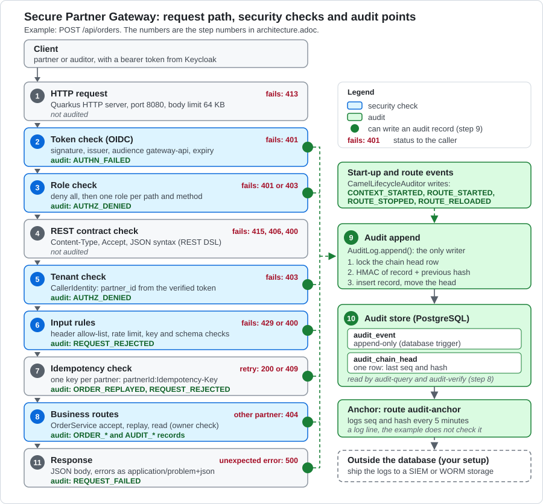

= Secure Partner Gateway: architecture guide
:toc:
:toclevels: 1

For a Java developer who opens this example for the first time. Build and run steps are in the link:../README.adoc[README].

`GatewayRoutes.java:81` means `file:line`. Java files are in `src/main/java/org/acme/partner/gateway/`
(and its `audit` and `order` folders), `application.properties` is in `src/main/resources/`.
The numbers match the code next to this guide. Update them when the code changes.
Behavior was checked on a running gateway, except where marked *(not run)*.

== What it does

* Partner systems send orders (`POST /api/orders`) and read their own orders (`GET /api/orders/\{id}`).
* Auditors read the audit trail and check it (`GET /api/audit`, `GET /api/audit/verify`).
* Quarkus OIDC checks the token and the role. Camel routes do the rest: tenant, limits, validation, idempotency.
* A partner sees only its own data. Its id is the signed `partner_id` claim of the token, never a header or a body field.
* Orders, reads, denials and failures go to an audit table in PostgreSQL. Each record is chained to the one before with an HMAC.

Stack: Camel Quarkus (platform-http, REST DSL, JPA), Quarkus OIDC with Keycloak, PostgreSQL with Flyway.

== The request path

The numbers in the picture are the step numbers below. `POST /api/orders` goes through all of them.

. *HTTP request.* Quarkus takes it on port 8080. A body over 64 KB gets `413`. (`application.properties:29`)
. *Token check.* `quarkus-oidc` checks signature, issuer, audience `gateway-api` and expiry before routing.
A bad token gets `401` and an `AUTHN_FAILED` record. (`application.properties:37-42`, `audit/SecurityEventAuditor.java:38-42`)
. *Role check.* Everything is denied, except one role per path and method. In the test realm the roles are Keycloak
realm roles (`realm_access.roles` in the token). No token gets `401`. Wrong role, path or method gets `403`.
Both write `AUTHZ_DENIED`.
(`application.properties:48-60`, `audit/SecurityEventAuditor.java:44-48`)
. *REST contract check.* The REST DSL checks Content-Type (`415`), Accept (`406`) and JSON syntax (`400`). (`GatewayRoutes.java:71-77`)
. *Tenant check.* The route starts with `CallerIdentity`. It builds the `Caller` (name, `partner_id`, address)
from the token Quarkus verified. A partner token without `partner_id` gets `403`.
(`GatewayRoutes.java:81-82`, `CallerIdentity.java:44-59`, `audit/Caller.java:33-41`)
. *Input rules,* in this order: `removeHeaders` keeps only `Idempotency-Key`; rate limit per partner (`429`);
key format (`400`); JSON schema `schema/order.json` (`400`); parse into `OrderRequest`. (`GatewayRoutes.java:83-88`)
. *Idempotency check.* The key `partnerId:Idempotency-Key` is saved in table `camel_messageprocessed`.
A known key skips the order creation and takes the replay branch.
(`GatewayRoutes.java:90-93`, `IdempotencyKeyRepository.java:37-48`)
. *Business routes.* `order-create` calls `OrderService.accept` (new key, `202`) or `replay` (known key, `200`,
or `409` if the first request has not saved its order yet). `order-read` calls `OrderService.read`, which checks the owner
(`404` for another partner's order). `audit-query` and `audit-verify` call `AuditLog`.
(`GatewayRoutes.java:94-126`, `order/OrderService.java:41-79`)
. *Audit append.* Every audit record goes through `AuditLog.append`: lock the chain head row, compute the HMAC,
insert the record, move the head. The steps with a green dot in the picture call it (2, 3, 5, 6, 7, 8, 11),
and so does the start-up listener. It is not a step after step 8. (`audit/AuditLog.java:73-82`)
. *Audit store.* Table `audit_event` with an append-only trigger, and the one-row table `audit_chain_head`.
The route `audit-anchor` logs the head every 5 minutes. (`V1.0.0__gateway_schema.sql:40-79`, `GatewayRoutes.java:130-132`)
. *Response.* The body is marshalled to JSON. An exception in any route goes to `ErrorHandling`: it writes the audit record
and answers with `application/problem+json`. (`GatewayRoutes.java:107`, `ErrorHandling.java:59-110`)

The other endpoints start with steps 1 to 5 and end in step 8.
`order-read` has no rate limit and no idempotency (`GatewayRoutes.java:109-113`).
`audit-query` keeps only `actor`, `action` and `limit`, and checks `limit` (1 to 999) (`GatewayRoutes.java:115-120`).
`audit-verify` drops all headers (`GatewayRoutes.java:122-126`).

== How the routes are secured

[cols="3,1,5,4",options="header"]
|===
|Endpoint (route id) |Role |Tenant rule |Enforced in

|`POST /api/orders` (`order-create`)
|`partner`
|`partner_id` comes only from the signed claim. It scopes the rate limit, the idempotency key and the stored order.
Body and headers cannot set it.
|Role: `application.properties:52-54`. Claim: `audit/Caller.java:37-38`, `CallerIdentity.java:56-58`.
Scope: `GatewayRoutes.java:83-85,90`, `order/OrderService.java:43`, `schema/order.json:6`

|`GET /api/orders/\{id}` (`order-read`)
|`partner`
|Own orders only. Another partner's order answers like an unknown id: `404`.
|Role: `application.properties:55-57`. Owner check: `order/OrderService.java:70-76`

|`GET /api/audit` (`audit-query`)
|`auditor`
|None. An auditor has no `partner_id` and sees all partners.
|Role: `application.properties:51,58-60`. `audit/AuditLog.java:87-107`

|`GET /api/audit/verify` (`audit-verify`)
|`auditor`
|None.
|Role: `application.properties:51,58-60`. `audit/AuditLog.java:112-124`

|any other path or method
|nobody
|-
|`application.properties:48-49`

|port 9876: `/observe/health`, `/observe/metrics`
|none, no authentication
|-
|`application.properties:31-34`. The permission rules do not cover this port. Do not expose it.
|===

There is no row-level security in the database. Tenant isolation is the owner check in `OrderService`
plus the `partner_id` column (`NOT NULL`, `V1.0.0__gateway_schema.sql:21`).

What the caller gets:

[cols="4,1,6",options="header"]
|===
|Situation |HTTP |Audit record and code

|No token
|`401`
|`AUTHZ_DENIED`, actor `anonymous`, reason `no credentials`. `audit/SecurityEventAuditor.java:44-48`

|Invalid token: garbage, changed claim, expired, wrong issuer, wrong audience
|`401`
|`AUTHN_FAILED`, actor `anonymous`, reason `AuthenticationFailedException` for all of them. `audit/SecurityEventAuditor.java:38-42`

|Wrong role, unlisted path or method (valid token)
|`403`
|`AUTHZ_DENIED`, the real actor, reason `forbidden`. `audit/SecurityEventAuditor.java:44-48`

|Another partner's order, or an unknown order
|`404`
|`ORDER_READ_DENIED`, reason `order of another partner` or `unknown order`. The answer is the same for both.
`order/OrderService.java:70-76`, `ErrorHandling.java:78-79,98-104`

|Partner token without `partner_id`
|`403`
|`AUTHZ_DENIED`, reason `partner token without partner_id claim`. `CallerIdentity.java:56-58`, `ErrorHandling.java:73-75`
|===

* The `401` and `403` of steps 2 and 3 come from Quarkus and have an empty body. The `403` for a missing `partner_id` and
the `404` come from a route and have a `problem+json` body.
* A wrong tenant on `POST /api/orders` cannot happen: there is no tenant input. A body field `partnerId` gets `400`
(`additionalProperties` is `false`). An `X-Partner-Id` header is dropped.
* The rate limit counts in memory, per gateway instance. Two instances each let 10 requests per second through for the same partner.
(`GatewayRoutes.java:84-85`, `application.properties:73-74`)
* Known issue: the `403` for a missing `partner_id` echoes request headers back (tried: `X-Probe` came back, `Cookie` and
`Authorization` did not). `CallerIdentity` throws before `removeHeaders` runs. The other answers send back only the allowed
`Idempotency-Key`. (`CallerIdentity.java:56-58`, `GatewayRoutes.java:82-83`)
* Known issue: an empty `partner_id` claim is not caught. It counts as a partner with an empty id. (`audit/Caller.java:37-38`) *(not run)*

== What is logged

=== Where records are written

`AuditLog.append` is the only code that inserts into `audit_event` (`audit/AuditLog.java:73-82`, the insert is line 79).
These classes call it:

[cols="3,6,4",options="header"]
|===
|Writer |Actions |Code

|`OrderService`
|`ORDER_ACCEPTED`, `ORDER_REPLAYED`, `ORDER_READ`
|`order/OrderService.java:45,61,77`

|`AuditLog`
|`AUDIT_QUERIED`, `AUDIT_VERIFIED`
|`audit/AuditLog.java:105,121-122`

|`ErrorHandling`
|`REQUEST_REJECTED` (`400`, `429`, `409`), `AUTHZ_DENIED` (`403`, no `partner_id`), `ORDER_READ_DENIED` (`404`), `REQUEST_FAILED` (`500`)
|`ErrorHandling.java:64-87,105`

|`SecurityEventAuditor`
|`AUTHN_FAILED` (`401`), `AUTHZ_DENIED` (`401` without token, `403`)
|`audit/SecurityEventAuditor.java:38-48`

|`CamelLifecycleAuditor`
|`CONTEXT_STARTED`, `ROUTE_STARTED`, `ROUTE_STOPPED`, `ROUTE_RELOADED` *(not run)*
|`audit/CamelLifecycleAuditor.java:33-50`
|===

The fields of a record are in `README.adoc:204-208`. No bodies, no tokens.
`Caller.of` marks a caller as `CLIENT` only if the token has `partner_id`, so a partner token without it is recorded as `USER`.
(`audit/Caller.java:37-39`)

The guarantee is not the same everywhere:

* *The business records* (`ORDER_ACCEPTED`, `ORDER_REPLAYED`, `ORDER_READ`) are written in the same transaction as the change
(`order/OrderService.java:28-30`).
If the audit insert fails, the order is rolled back and the caller gets `500` (and a `REQUEST_FAILED` record, if that insert works).
There is no order without its record.
* *`AUTHN_FAILED` and `AUTHZ_DENIED` from Quarkus* are written by asynchronous observers (`audit/SecurityEventAuditor.java:29-30,38,44`).
If the write fails, the caller still gets `401` and only an ERROR in the application log remains. The record is lost.

=== What is not audited

* `413`, `415`, `406` and the `400` for malformed JSON. They are answered before the route runs, as plain answers
(not `problem+json`). (`GatewayRoutes.java:71`, `application.properties:29`)
All other `400` answers (key, schema, `limit`) are audited as `REQUEST_REJECTED`.
* Calls to the management port.
* A valid token. Only failures and actions leave records. (`audit/SecurityEventAuditor.java:38,44`)
* Stopping the Camel context. There is no listener for it. Stopped routes are recorded. (`audit/CamelLifecycleAuditor.java:33-47`)
* Why a token failed, and whose it was. For `401` the actor is `anonymous` and the reason is only the exception class,
because the messages of token errors can contain claims. (`audit/SecurityEventAuditor.java:39`)

=== The hash chain, in plain words

. Every record gets the next `seq` (1, 2, 3, ...) and, as `prevHash`, the `hash` of the record before it.
The first one uses 64 zeros. (`audit/AuditChain.java:36`, `V1.0.0__gateway_schema.sql:64-65`)
. Its own `hash` is an HMAC-SHA256 over all its fields and `prevHash`, with the secret key `AUDIT_HMAC_KEY`.
Each field is length-prefixed, so characters cannot move from one field into the next. (`audit/AuditChain.java:73-104`)
. Without the key nobody can compute a valid hash. A changed, missing or reordered record breaks the chain from there on.
The one gap is the end of the chain (see Anchors).
. Every append locks the single row in `audit_chain_head`, so two requests never get the same `seq`.
(`audit/AuditLog.java:75`, `audit/AuditChainHead.java:23-49`)

The key is the text of `AUDIT_HMAC_KEY` as it is (UTF-8 bytes, not base64-decoded). (`audit/AuditChain.java:43`)

=== Verification

`GET /api/audit/verify` walks all records by `seq` and checks: no gap in `seq`, each `prevHash` is the hash before it,
the recomputed HMAC equals the stored `hash`, and the last record is the one in `audit_chain_head`.
(`audit/AuditLog.java:112-124`, `audit/AuditChain.java:54-71`)
The answer is `{"valid":true,"checked":42}` or `{"valid":false,"checked":6,"brokenAtSeq":7}`, with the first bad `seq`.

* The HTTP status is `200` in both cases. Look at `valid`.
* A broken chain is logged as ERROR (`Audit chain is broken at seq 7`) and recorded as `AUDIT_VERIFIED` with reason
`broken at seq 7`. The outcome of that record is still `SUCCESS`.
* The check loads the whole chain and blocks appends meanwhile.

=== What a tampering attempt looks like

Tried against a dev-mode gateway, as the database owner.

[cols="4,5",options="header"]
|===
|Attempt |Result

|`UPDATE`, `DELETE` or `TRUNCATE` on `audit_event`
|Rejected by the trigger: `audit_event is append-only, UPDATE is not allowed` (`V1.0.0__gateway_schema.sql:67-79`)

|Owner switches the trigger off, edits record 16
|`verify`: `{"valid":false,"checked":15,"brokenAtSeq":16}`. Deleting record 50 gives `brokenAtSeq` 50.

|Owner changes only the hash in `audit_chain_head`
|`verify`: `brokenAtSeq` is the last `seq` plus 1. The next append is chained to the wrong hash, so the chain stays broken.

|Owner deletes the newest records and sets `audit_chain_head` back
|`verify`: `{"valid":true,...}`. *Not detected.* Only an anchor shows it.

|Owner with the HMAC key rewrites records and recomputes all later hashes
|`verify`: valid. Only an anchor shows it. *(not run)*
|===

The trigger works only while it is on, and only the table owner (or a superuser) can switch it off.
Flyway runs with the application's datasource (`application.properties:66-67`), so unless you configure another Flyway user,
the application's own database user owns the tables. The README checklist asks to split these roles (`README.adoc:260`).

=== Anchors and their limits

The route `audit-anchor` logs the chain head every 5 minutes (`audit.anchor-period`): `Audit chain head: seq=21 hash=c99a...`.
(`GatewayRoutes.java:130-132`, `audit/AuditLog.java:129-133`, `application.properties:82`)
In the JSON logs of the `prod` profile the logger name is `audit-anchor`.

An anchor is a copy of `seq` and `hash` outside the database, *once your log shipping has moved it to a system that the
database admins cannot change*. Later the database must still hold record `seq` with exactly that hash.
If it is missing or has another hash, the chain was cut or rewritten up to that `seq`.

What is true about the limits:

* `verify` cannot see records cut from the end when `audit_chain_head` is set back as well.
`README.adoc:225-227` and `audit/AuditChain.java:31-32` say this, and it is true.
Tried: with the 3 newest records deleted and the head set back, `verify` answered `{"valid":true,"checked":18}`,
while the last anchor (`seq=21`) found no record.
* Nothing in the example reads the anchors, and `verify` does not know them. You compare them yourself or with a rule in your log system.
* An anchor covers the records up to its `seq`. Records written after the last anchor (up to 5 minutes by default) have no copy.
* The route only writes a log line. It is an anchor only after the log has left the host.
* A head that goes back, or has another hash for the same `seq`, between two anchors is the sign of a cut.

To try the cut in dev mode (use a `seq` that exists, a few below the newest):

[source,sql]
----
ALTER TABLE audit_event DISABLE TRIGGER audit_event_no_update_or_delete;
DELETE FROM audit_event WHERE seq > 18;
UPDATE audit_chain_head SET seq = 18, hash = (SELECT hash FROM audit_event WHERE seq = 18);
ALTER TABLE audit_event ENABLE TRIGGER audit_event_no_update_or_delete;
----

== The order workflow

. The partner calls `POST /api/orders` with `Idempotency-Key` (8 to 64 of `A-Z a-z 0-9 - _`) and a body like
`{"sku":"WIDGET-1","quantity":2}`: `sku` 3 to 32 of `A-Z 0-9 -`, `quantity` 1 to 1000, no other field. (`schema/order.json`)
Steps 1 to 6 of the request path pass.
. The key `partnerId:key` is inserted into `camel_messageprocessed` and committed at once, in its own transaction.
A unique constraint makes a parallel request with the same key a duplicate too.
(`IdempotencyKeyRepository.java:26-48`, `V1.0.0__gateway_schema.sql:35`)
. `OrderService.accept` runs in one transaction: it inserts the row in `partner_order` (with the caller's `partner_id`)
and the `ORDER_ACCEPTED` record. Answer: `202 {"orderId":"..."}`.
(`order/OrderService.java:41-47`, `V1.0.0__gateway_schema.sql:19-27`)

A retry with the same key:

[cols="4,2,5",options="header"]
|===
|Case |Answer |Why

|The first request is done
|`200`, same `orderId`
|`replay` finds the order by partner and key and writes `ORDER_REPLAYED`. (`order/OrderService.java:52-63`)

|The first request is done, the body is different
|`200`, the first order
|Only the key identifies a retry. The body is not compared.

|The first request still runs
|`409`
|The key is committed, the order is not. `replay` finds nothing. (`order/OrderService.java:60`)
With 8 parallel requests: one `202`, the others `200` or `409`.

|The first request failed inside `accept` (for example a database error)
|`500`, then the same key works again
|The key is released when the block fails.

|Same key, another partner
|a new order, `202`
|The key includes the partner. (`GatewayRoutes.java:90`)

|A key without an order (for example a crash between the two commits)
|`409` for every retry
|It stays until the row is deleted from `camel_messageprocessed`. Nothing in the example deletes keys. (`README.adoc:241-243`)
|===

The replay is outside of the idempotent block, so a failure there cannot release the key of the first request.
(`GatewayRoutes.java:101-106`)

== Configuration that matters

[cols="3,4,4",options="header"]
|===
|Setting |dev and test |prod

|OIDC server
|Dev Services start Keycloak (dev: port 8082) with `config/gateway-realm.json` (`application.properties:94-95`)
|`QUARKUS_OIDC_AUTH_SERVER_URL`, no default

|Database
|Dev Services start PostgreSQL
|`QUARKUS_DATASOURCE_JDBC_URL`, `QUARKUS_DATASOURCE_USERNAME`, `QUARKUS_DATASOURCE_PASSWORD`, no default

|HMAC key `audit.hmac-key`
|Fixed keys in the file, for dev and test only (`application.properties:80-81`)
|`AUDIT_HMAC_KEY`, no default, see below

|Rate limit
|10 per 1 s per partner in dev, 100 per 60 s in test (`application.properties:73-77`)
|10 per 1 s. `GATEWAY_THROTTLE_MAX_REQUESTS`, `GATEWAY_THROTTLE_PERIOD`

|Anchor period
|`audit.anchor-period = 5m` (`application.properties:82`)
|same, `AUDIT_ANCHOR_PERIOD`
|===

Also: `camel.main.profile = prod` only in `prod` (`application.properties:26`). Logs are JSON with `partnerId` and
`camel.exchangeId` in `prod`, plain text in dev and test (`application.properties:85-88`). API on 8080, management on 9876.
The prod jar listens on all interfaces, also on the management port, which has no authentication.

`AUDIT_HMAC_KEY` in `prod`:

* Missing: the application does not start (`Failed to load config value of type class java.lang.String for: audit.hmac-key`).
* Shorter than 32 characters: the application does not start (`audit.hmac-key must have at least 32 characters`).
(`audit/AuditLog.java:45,61-67`)
* The records have no key id. A different key makes `verify` report the chain broken from `seq` 1, so old records can no longer
be verified. (`README.adoc:237`, unit test `AuditChainTest.wrongKeyIsDetected`)
* Keep the key out of the database. Whoever has the key and the database can rewrite the chain.
* Tests of the packaged application use the `test` profile for the key (`application.properties:98`).

== Try it

Start dev mode (`mvn clean compile quarkus:dev`, needs Docker or Podman) and get the tokens.
They last 5 minutes. Get new ones when you see `401`. Ids and times in the outputs differ on your machine.

[source,shell]
----
TOKEN_URL=http://localhost:8082/realms/gateway/protocol/openid-connect/token
ACME=$(curl -s -d grant_type=client_credentials -d client_id=partner-acme -d client_secret=acme-test-secret $TOKEN_URL | jq -r .access_token)
GLOBEX=$(curl -s -d grant_type=client_credentials -d client_id=partner-globex -d client_secret=globex-test-secret $TOKEN_URL | jq -r .access_token)
AARON=$(curl -s -d grant_type=password -d client_id=audit-console -d username=aaron -d password=aaron-test-password $TOKEN_URL | jq -r .access_token)
NOTENANT=$(curl -s -d grant_type=client_credentials -d client_id=partner-without-tenant -d client_secret=without-tenant-test-secret $TOKEN_URL | jq -r .access_token)
----

*1. An order, sent twice with the same key*

[source,shell]
----
KEY=$(uuidgen)
for i in 1 2; do
  curl -s -w ' %{http_code}\n' -H "Authorization: Bearer $ACME" -H "Idempotency-Key: $KEY" \
    -H 'Content-Type: application/json' -d '{"sku":"WIDGET-1","quantity":2}' http://localhost:8080/api/orders
done
----

----
{"orderId":"3f883022-a127-41b3-907c-e43526fb28ff"} 202
{"orderId":"3f883022-a127-41b3-907c-e43526fb28ff"} 200
----

*2. Read it as the owner and as another partner*

[source,shell]
----
ORDER_ID=<orderId from above>
curl -s -w ' %{http_code}\n' -H "Authorization: Bearer $ACME" http://localhost:8080/api/orders/$ORDER_ID
curl -s -w ' %{http_code}\n' -H "Authorization: Bearer $GLOBEX" http://localhost:8080/api/orders/$ORDER_ID
curl -s -w ' %{http_code}\n' -H "Authorization: Bearer $GLOBEX" http://localhost:8080/api/orders/$(uuidgen)
----

----
{"orderId":"3f883022-...","sku":"WIDGET-1","quantity":2,"createdAt":"2026-10-27T13:01:38.208386Z"} 200
{"type":"about:blank","title":"Not Found","status":404,"detail":"Order not found"} 404
{"type":"about:blank","title":"Not Found","status":404,"detail":"Order not found"} 404
----

*3. No token, bad token, wrong role, partner without `partner_id`*

[source,shell]
----
curl -s -o /dev/null -w '%{http_code}\n' http://localhost:8080/api/orders/$ORDER_ID
curl -s -o /dev/null -w '%{http_code}\n' -H "Authorization: Bearer garbage" http://localhost:8080/api/orders/$ORDER_ID
curl -s -o /dev/null -w '%{http_code}\n' -H "Authorization: Bearer $ACME" http://localhost:8080/api/audit
curl -s -w ' %{http_code}\n' -H "Authorization: Bearer $NOTENANT" -H "Idempotency-Key: $(uuidgen)" \
  -H 'Content-Type: application/json' -d '{"sku":"WIDGET-1","quantity":2}' http://localhost:8080/api/orders
----

----
401
401
403
{"type":"about:blank","title":"Forbidden","status":403,"detail":"The caller is not assigned to a partner"} 403
----

*4. Bad input: a `400` that is audited and a `415` that is not*

[source,shell]
----
curl -s -w ' %{http_code}\n' -H "Authorization: Bearer $ACME" -H "Idempotency-Key: $(uuidgen)" \
  -H 'Content-Type: application/json' -d '{"sku":"WIDGET-1","quantity":0}' http://localhost:8080/api/orders
curl -s -w ' %{http_code}\n' -H "Authorization: Bearer $ACME" -H "Idempotency-Key: $(uuidgen)" \
  -H 'Content-Type: text/plain' -d 'WIDGET-1 x 2' http://localhost:8080/api/orders
----

----
{"type":"about:blank","title":"Bad Request","status":400,"detail":"The request does not match the API contract"} 400
 415
----

*5. The audit trail and its check*

[source,shell]
----
curl -s -H "Authorization: Bearer $AARON" 'http://localhost:8080/api/audit?limit=5' | jq -c '.[] | {seq,action,outcome,actor}'
curl -s -H "Authorization: Bearer $AARON" http://localhost:8080/api/audit/verify
----

The records of examples 3 and 4, newest first. The `415` left none.

----
{"seq":131,"action":"REQUEST_REJECTED","outcome":"REJECTED","actor":"service-account-partner-acme"}
{"seq":130,"action":"AUTHZ_DENIED","outcome":"DENIED","actor":"service-account-partner-without-tenant"}
{"seq":129,"action":"AUTHZ_DENIED","outcome":"DENIED","actor":"service-account-partner-acme"}
{"seq":128,"action":"AUTHN_FAILED","outcome":"DENIED","actor":"anonymous"}
{"seq":127,"action":"AUTHZ_DENIED","outcome":"DENIED","actor":"anonymous"}
{"valid":true,"checked":132}
----

*6. Tamper with the chain (dev mode only)*

Find the PostgreSQL container with `podman ps` and use its name. Pick a `seq` from example 5 (here 16).
This breaks the chain of the dev database. Restart dev mode to get a new one.

[source,shell]
----
PSQL="podman exec <container> psql -U quarkus -d quarkus"
$PSQL -c "UPDATE audit_event SET resource = 'order/forged' WHERE seq = 16"
$PSQL -c "ALTER TABLE audit_event DISABLE TRIGGER audit_event_no_update_or_delete" \
      -c "UPDATE audit_event SET resource = 'order/forged' WHERE seq = 16" \
      -c "ALTER TABLE audit_event ENABLE TRIGGER audit_event_no_update_or_delete"
curl -s -H "Authorization: Bearer $AARON" http://localhost:8080/api/audit/verify
----

----
ERROR:  audit_event is append-only, UPDATE is not allowed
...
{"valid":false,"checked":15,"brokenAtSeq":16}
----

== Where to start reading

. `README.adoc` and `application.properties`: endpoints, deny by default, OIDC, limits, HMAC key, anchor period.
. `GatewayRoutes.java`: the REST DSL and the five routes. Read `order-create` first.
. `CallerIdentity.java` and `audit/Caller.java`: where the caller and the tenant come from.
. `ErrorHandling.java`: every error answer and its audit record.
. `order/OrderService.java` and `IdempotencyKeyRepository.java`: the business code and the idempotency key.
. `audit/AuditLog.java` and `audit/AuditChain.java`: append, hash chain, verify.
. `audit/SecurityEventAuditor.java` and `audit/CamelLifecycleAuditor.java`: the records that do not come from a route.
. `V1.0.0__gateway_schema.sql` and `config/gateway-realm.json`: tables and trigger, test clients and roles.
. Tests: `SecurityTest`, `AuditTrailTest`, `OrderApiTest` (behavior) and `audit/AuditChainTest` (the chain, no database).
